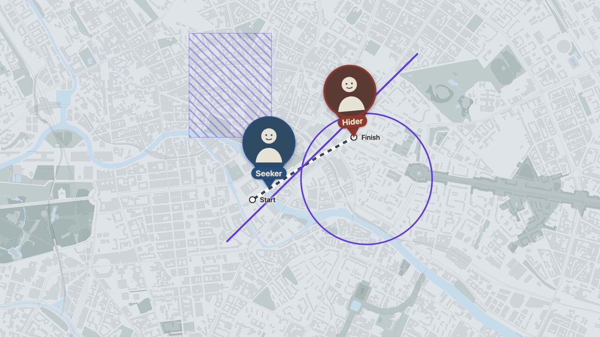

# Map Animations Kit

A small, code-driven renderer for map animation clips. You describe a clip as
declarative JSON, the kit resolves the data, paints the overlays, captures one
frame at a time with Playwright, and encodes a ProRes 4444 master with alpha.

It was extracted from a production project that rendered 120 map clips for a
fan-made travel-game video series. The production data and the original scenes
are not included. What remains is the architecture, the renderer laws, and the
authoring workflow.



## What you get

- A declarative scene format: camera, lines, line entrances, exclusions, rides,
  Seeker and Hider pins, station labels, free points, segments, paths, and
  context circles.
- A named recipe registry for motion and styling laws. Scenes never carry raw
  motion numbers.
- A deterministic frame loop: no animation APIs, no CSS transitions, no
  randomness. Same scene + same data + same tiles = pixel-identical output.
- A zero-dependency scene validator and an optional geo database validator.
- A camera picker and a single-frame probe tool.
- An opencode workflow: a `create-scene` skill, a `style-tokens` gate, and a
  repo-scoped render tool that survives the 120 s shell timeout.

## Quick start

Requirements:

- Node 20 or newer
- ffmpeg with ProRes support
- Playwright Chromium: `npx playwright install chromium`

```sh
npm install
npm test
```

`npm test` validates the optional geo database and every scene. The kit ships
no geo data, so the geo check is a clean no-op.

Render the demo:

```sh
npm run render -- scenes/demo-01-city-tour.json
```

The master lands in `./renders/demo-01-city-tour-full.mov` with a
`render-log-demo-01-city-tour-full.json` next to it. Set `MAP_RENDER_OUT` to
write somewhere else.

Probe a single frame without a full render:

```sh
npm run probe -- scenes/demo-01-city-tour.json 72 --out=/tmp/probe
```

Open the camera picker:

```sh
npm run camera-picker
# http://127.0.0.1:8123/tools/camera-picker/page/index.html
```

## How it works

Five layers, each with one owner:

```
data/geo/        WHERE things are       optional GeoJSON, slug ids, line colors
scenes/*.json    WHAT happens           declarative story, frame-exact timecodes
recipes/*.json   HOW it moves           named motion laws and defaults
style/style.json HOW it looks           basemap style and paint tokens
render/          INTERPRET              resolve, project, paint, capture, encode
```

The renderer owns no choreography. If a scene needs a different blink rhythm,
it references a recipe with overrides. If a scene needs a different color, that
is not a scene field; colors are frozen tokens. If a station moves, the geo
database changes, not every scene.

Every frame is a pure function of `t = frame / 24`. The renderer jumps the
camera, waits for tiles, projects overlays with `map.project()`, paints a 2D
stripe canvas, screenshots, and moves on. There are no MapLibre animation APIs
and no CSS-driven marker fades. That is what makes re-renders reproducible.

## Scene format

Scenes live in `scenes/<project>-<nn>-<slug>.json`. All time is strict
`(HH:)MM:SS:FF` at 24 fps. Each element carries a `window: [start, end]`.

```jsonc
{
  "scene": {
    "video": "demo",
    "nn": 1,
    "title": "City Tour",
    "length": "00:06:00",
    "framing": "full"
  },
  "camera": {
    "waypoints": [
      { "at": "00:00:00", "center": [13.407, 52.518], "zoom": 13.4 },
      { "at": "00:06:00", "center": [13.412, 52.520], "zoom": 14.2 }
    ]
  },
  "exclusions": [
    {
      "id": "block",
      "shape": { "type": "Polygon", "coordinates": [[ /* … */ ]] },
      "entry": { "recipe": "blink-then-stay", "window": ["00:02:00", "00:04:00"] }
    }
  ]
}
```

Framings:

- `full`: 1920×1080 map.
- `half`: 806 px left strip, 42% of the frame, transparent right side.
- `half-right`: 806 px right strip, transparent left side.
- `half-bottom`: 1920×454 bottom strip, transparent top.

One scene equals one framing. The renderer hard-errors if `--framing` does not
match the scene.

Full reference: [`docs/SCENE-FORMAT.md`](docs/SCENE-FORMAT.md). Recipe
semantics: [`docs/RECIPES.md`](docs/RECIPES.md).

## Data is optional

The demo scenes use hand-authored coordinates only. If you want station and
line slugs, add the optional geo database described in
[`data/geo/README.md`](data/geo/README.md). The scene validator degrades slug
checks to warnings when the database is absent.

The basemap uses hosted OpenFreeMap tiles by default, so the demo renders
without a tile download. For deterministic, offline production renders, put a
PMTiles extract in `data/tiles/` and switch the style source as described in
[`data/tiles/README.md`](data/tiles/README.md).

## Output

A render produces exactly two files per scene, flat in `./renders/`:

```
<stem>-<variant>.mov              ProRes 4444, yuva444p10le, 16 alpha bits
render-log-<stem>-<variant>.json  per-frame capture times
```

There is no preview proxy. PNG frames live in the OS temp directory and are
deleted after a successful encode. `--keep-frames` retains them for debugging.

## Project layout

```
render/           production renderer
  render.mjs      per-scene driver: validate, resolve, serve, capture, encode
  server.mjs      loopback HTTP server and scene injection
  geo.mjs         optional slug resolution against data/geo
  interpreter.js  browser-side motion laws
  page/           MapLibre page, pins, labels, stripe canvas
scripts/          validate-geo.mjs, validate-scene.mjs
recipes/          recipes.json (normative) and README.md (semantics)
scenes/           demo scenes and optional shared shapes
data/geo/         optional geo database
data/tiles/       optional local PMTiles
style/            basemap style
assets/images/    pin photos (demo placeholders)
docs/             format, recipes, architecture, design notes, env
tools/            camera-picker, probe-frame
.opencode/        skills, rules, render tool, plugin
```

## Design notes

The renderer laws and the pitfalls that produced them are documented in
[`docs/DESIGN-NOTES.md`](docs/DESIGN-NOTES.md). Read that before changing the
renderer. The short version:

- Drive everything from `t = frame / 24`.
- Use `map.jumpTo`, then poll `areTilesLoaded()`, then settle, then screenshot.
- Never use `once('idle')` after a same-camera jump.
- Use subpixel positioning for every DOM marker.
- Stripes are a 2D canvas overlay, never `fill-pattern`.
- Anchor stripes and dashes to the Web-Mercator ground plane.
- Never `ctx.clip()` on huge exclusion paths.
- In half framings, the camera center is the strip center.
- Fades are clamped to half the window; a window ending at the scene length
  needs `fade-out: 0` if the element must persist.

## opencode workflow

The repo includes an opencode setup in `.opencode/`:

- `create-scene` skill: interview, author, validate, render, self-review.
- `style-tokens` skill: the gate for look and recipe changes.
- `render` tool: runs long renders inside the opencode host, away from the
  120 s shell timeout.
- `renders` and `read-images` rules.

Install the plugin dependency once if you want the tool:

```sh
cd .opencode && npm install && cd ..
```

Restart opencode after changing `.opencode/tools/`. The npm scripts work
without opencode.

## Limitations

- This is a kit, not a general motion-graphics framework. It renders map clips.
- Exclusions are hand-authored. There is no isochrone or routing engine.
- Attribution and title cards are never rendered. Composite them in your
  editor for published work.
- The style has no symbol layers. All on-screen text comes from station names,
  renderer constants, or `points[].text`.
- The camera picker and Finder reveal are macOS-friendly. The renderer itself
  runs anywhere Node, Chromium and ffmpeg run.

## Attribution

The demo uses hosted OpenFreeMap tiles. For published video, composite:

> OpenFreeMap, © OpenMapTiles, Data from OpenStreetMap

If you add OpenStreetMap-derived geo data or local tiles, also credit
`© OpenStreetMap contributors` (ODbL) and `© OpenMapTiles` (CC-BY 4.0). See
[`ATTRIBUTION.md`](ATTRIBUTION.md).

## License

MIT. See [`LICENSE`](LICENSE).

The kit was extracted from a private production project. The original scenes,
photos, data and renders are not part of this repository.
